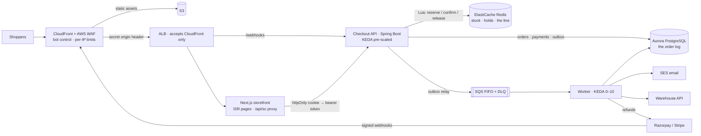

# Project 2 · SwiftCart Flash

**A flash-sale store for limited sneaker drops.** Thousands of shoppers press "buy" in the same second. The store
sells exactly the pairs it has, holds each buyer to the per-customer limit, charges every buyer once, and keeps
working when a payment arrives late, a webhook is lost, or Redis goes away.

[](https://github.com/ARGOD2213/swiftcart-flash/actions/workflows/ci.yml)

Spring Boot 3.4 (Java 21) · Next.js 16 · PostgreSQL 16 / Aurora Serverless v2 · Redis + Lua / ElastiCache ·
SQS FIFO · Razorpay · Stripe · EKS · KEDA · AWS WAF · CloudFront · Terraform · Argo CD · k6

---

## What it guarantees, and where it's proven

Each row is code in this repo plus tests that run on every push.

| Guarantee | How | Proven by |
|---|---|---|
| **Never oversells** | During a drop, stock lives in Redis and changes only inside Lua scripts, so the stock check and the decrement can't be split. All of a drop's keys share a `{dropId}` hash tag (Redis Cluster-safe), and ElastiCache runs `noeviction` so stock counters are never evicted ([ADR 0001](docs/adr/0001-stock-in-redis-during-a-drop.md)) | `InventoryIT` (11): 300 buyers race for 50 units and exactly 50 sell; the k6 audit in CI |
| **The per-customer limit can't be dodged** | The limit is counted in the same script, across orders and sizes. Phone numbers are normalised (`+91`, spaces, a leading `0`) and limited too, so a second account with the same phone shares the limit | `InventoryIT`, `CheckoutIT`, `PhonesTest` (15 cases), `demo.sh` |
| **A fair line nobody can skip** | Each drop has a waiting room with one ticket per account. A single leader (Postgres advisory lock) admits shoppers at a set rate, never before opening. Checkout requires a signed entry token, so calling the API directly doesn't help ([ADR 0003](docs/adr/0003-waiting-room-and-recovery.md)) | `WaitingRoomIT` (7), `demo.sh`, `storefront-smoke.sh` |
| **Double-clicks and retries create one order** | `Idempotency-Key`: a retry gets the stored response; the same key with a different body is `422`; the same key while the first request is still running is `409` + `Retry-After`; a request that died mid-flight is taken over after 60 s. The hold id is derived from (customer, key) | `CheckoutIT.aDoubleClickFiringTenRequestsAtOnceCreatesOneOrder` and 14 more; `demo.sh`, `storefront-smoke.sh` |
| **Every buyer is charged exactly once** | Webhooks are HMAC-verified over the raw body and de-duplicated in the same transaction as their effect. One function, `PaymentService.apply`, decides what every payment means. A second payment is refunded; a wrong amount goes to review; a late "failed" never undoes a capture ([ADR 0002](docs/adr/0002-charge-exactly-once.md)) | `PaymentFlowIT` (15), `RazorpayGatewayTest` (9), `StripeGatewayTest` (7) |
| **Late, lost and out-of-order payments** | A payment after the hold ended gets its units back if they're still there, and is refunded if not. The reconciler asks the gateway about orders whose webhook never came | `PaymentFlowIT.aLatePayment…`, `aLostWebhookIsFoundByTheReconciler`, `demo.sh` |
| **Unpaid holds go back on sale** | Holds expire after the drop's TTL (the reaper, leader-elected). A database safety net releases holds that Redis forgot to expire | `ReaperAndRebuildIT`, `demo.sh` |
| **Survives losing Redis** | Stock, holds and limits are rebuilt from the Postgres order log. Payments that arrive during a rebuild are retried, not refunded | `ReaperAndRebuildIT.whenRedisLosesADropItIsRebuiltFromTheOrderLogAndLimitsStillHold` |
| **Fulfilment happens once, per order, in order** | Transactional outbox → SQS FIFO (group = order, dedup = event id) → worker: a gapless invoice number per financial year (April–March), an email, a warehouse shipment, and refunds with idempotency keys | `FulfilmentIT` (5), `demo.sh` |
| **Ready before the crowd arrives** | `/internal/scaling` tells KEDA how many checkout pods the next drop needs from 15 minutes before it opens. Workers scale from 0 to 10 on queue depth | `AdminAndScalingIT.checkoutPodsArePreScaledBeforeADropAndOnlyThen` |
| **The crowd hits the CDN, not the API** | Listing and product pages are ISR (30 s) and cached by CloudFront, and live stock is cached for 1 s. Everything personal goes through an httpOnly-cookie proxy that only reaches shopper endpoints | `storefront-smoke.sh` |
| **Accounts** | bcrypt; unknown emails take the same time as wrong passwords; an email is locked out after repeated failures; the token never reaches page scripts | `AuthIT` (7), `storefront-smoke.sh` |
| **Bots stop at the edge** | AWS WAF on CloudFront: Bot Control, a per-IP limit on joining the line, and a flood guard (webhooks exempt). The ALB only accepts CloudFront | `terraform validate` in CI (not applied; see the status note) |

CI runs **99 tests** against real Postgres, Redis and LocalStack (SQS) containers, with WireMock standing in for
Razorpay, Stripe and the warehouse. It then boots the whole stack with Docker Compose and runs:
[`scripts/demo.sh`](scripts/demo.sh) (every edge case above, step by step),
[`scripts/storefront-smoke.sh`](scripts/storefront-smoke.sh) (the storefront end to end) and the k6 load test below.
It also validates the Terraform and Kubernetes manifests and publishes both images to GHCR.

## Load test: a drop rehearsal in CI

[`loadtest/drop.js`](loadtest/drop.js) sends **1,500 shoppers after 300 pairs** (150 per size, 2 per customer),
300 at a time. Each shopper joins the line, waits to be admitted, checks out, and then pays, fails and retries, or
walks away. Walked-away holds expire and go back on sale. Then [`scripts/loadtest.sh`](scripts/loadtest.sh) audits
the drop from the database. A recent CI run:

```
drop load-…: 250 orders paid (300 pairs of 300), 1227 told sold out, 23 walked away;
             checkout p95 113 ms, queue wait p95 31 s, http failures 0.00%
sold 300 of 300 pairs
✓ no oversell, no one over the limit, no one charged twice
```

Every run sells exactly 300 of 300 and passes the audit. Checkout p95 has ranged from about 110 to 850 ms across
runs. The queue wait is the waiting room at work: admissions run at the drop's configured rate, so checkout never
sees more traffic than it was sized for. These numbers come from one shared CI runner with everything on it
(Postgres, Redis, LocalStack, API, worker, storefront and k6), not from production hardware. The point is the
audit, not the throughput.

## Architecture



**One purchase, end to end:**

1. The product page comes from CloudFront's cache. The browser polls live stock (cached for 1 s) and joins the line
   through the storefront's `/api/sc` proxy, which turns the httpOnly session cookie into a bearer token.
2. The leader admits the next tickets each second. The shopper's poll returns an **entry token** for this drop.
3. Checkout sends the entry token and an `Idempotency-Key`. `reserve.lua` checks, in one step, that the drop is
   open, the quantity, the customer and phone limits, and the stock. It then takes the units and records the hold
   with its expiry. The API writes the `PENDING_PAYMENT` order and creates the Razorpay order (or Stripe Checkout
   Session).
4. The shopper pays. The gateway's webhook (or the checkout callback, or the reconciler) goes through
   `PaymentService.apply`: the order row is locked, `confirm.lua` makes the hold permanent, the order is `PAID`,
   and an `ORDER_PAID` event goes into the outbox **in the same transaction**.
5. The relay publishes it to SQS FIFO. The worker issues the invoice, emails the shopper and books the shipment,
   each exactly once, and the order is `FULFILLED`. If nobody pays, the reaper returns the units when the hold
   expires.

## Run it locally

Needs Docker, plus `curl` and `jq` for the scripts.

```bash
docker compose -f deploy/docker-compose.yml up --build
# storefront http://localhost:3000 · API http://localhost:8080

# in another terminal
scripts/demo.sh              # every edge case, step by step
scripts/storefront-smoke.sh  # the storefront end to end
scripts/loadtest.sh          # 1,500 shoppers, 300 pairs, then the audit
```

Locally, payments go through a built-in **simulator** that sends Razorpay-format signed webhooks through the
normal webhook path, and the warehouse is a WireMock stub. To create a drop to click through:

```bash
curl -X POST "localhost:8080/dev/drops/demo?slug=midnight-runner&stock=5"
# open http://localhost:3000/drops/midnight-runner, register, join the line, buy, "pay"
```

`/dev/*` exists only in the `dev` profile. Admin endpoints (`/api/admin/drops/…`: create, arm, pause admissions,
rebuild inventory, audit) need an account listed in `ADMIN_EMAILS` (`admin@swiftcart.local` locally).

To use real gateways in test mode, set `PAYMENT_GATEWAY=razorpay` with `RAZORPAY_KEY_ID`,
`RAZORPAY_KEY_SECRET` and `RAZORPAY_WEBHOOK_SECRET`, or `PAYMENT_GATEWAY=stripe` with `STRIPE_SECRET_KEY` and
`STRIPE_WEBHOOK_SECRET`. Then point the gateway's webhook (for example `stripe listen --forward-to
localhost:8080/webhooks/stripe`) at `/webhooks/{gateway}`.

**Tests:** `cd api && mvn verify` (Testcontainers starts everything it needs). **Storefront:**
`cd web && npm ci && npm run dev` with `API_URL=http://localhost:8080`.

## Deploy to AWS

Infrastructure is Terraform in [`infra/terraform`](infra/terraform). Workloads are Kustomize in [`k8s`](k8s),
synced by Argo CD.

| Terraform creates | Notes |
|---|---|
| VPC across 3 AZs | public (ALB, NAT), private (EKS), isolated database and cache subnets; S3 gateway endpoint |
| EKS + managed nodes | IRSA for the API, worker, KEDA, External Secrets and the LB controller |
| Aurora PostgreSQL 16 (Serverless v2) | writer + reader, TLS forced, KMS, backups; master credentials are used once, by the bootstrap script |
| ElastiCache Redis 7 | `maxmemory-policy noeviction`, Multi-AZ failover, TLS + AUTH, KMS; memory alarm |
| SQS FIFO fulfilment queue + DLQ | content-based dedup off (event ids instead), redrive, alarm when the DLQ isn't empty |
| CloudFront + S3 | static assets via OAC; a cache policy that honours ISR and keeps Next's HTML and RSC responses apart |
| AWS WAF ×2 | on CloudFront: Bot Control, common rules, per-IP line-join limit, flood guard. On the ALB: only requests with CloudFront's secret header |
| Secrets Manager | generated DB password, JWT and entry-token keys; gateway secrets added by you |

```bash
cd infra/terraform
cp backend.hcl.example backend.hcl && cp example.tfvars prod.tfvars   # edit both
terraform init -backend-config=backend.hcl
terraform apply -var-file=prod.tfvars
$(terraform output -raw configure_kubectl)
```

Then, once per cluster:

1. Helm-install the add-ons with the roles from `terraform output irsa_role_arns`: the AWS Load Balancer
   Controller, KEDA, the External Secrets Operator and Argo CD.
2. `kubectl apply -f deploy/cluster/cluster-secret-store.yaml`.
3. `infra/scripts/bootstrap-db.sh` creates the app's database role. The API runs its Flyway migrations on startup.
4. Add the gateway keys (`RAZORPAY_*` or `STRIPE_*`) to the app secret (`terraform output app_secret_name`).
   Register `https://<shop domain>/webhooks/razorpay` (or `/stripe`) with the gateway.
5. Fill the placeholders in `k8s/base` (account id, hosts, certificate, Aurora endpoint) from
   `terraform output app_config`, `irsa_role_arns` and `waf_acl_arn`. Then `kubectl apply -f argocd/application.yaml`;
   Argo CD syncs `k8s/overlays/prod` from `main`.
6. On each release, sync the storefront's `.next/static` to `_next/static/` and `public/images` to `images/` in the
   assets bucket (`terraform output assets_bucket`), then set the new image tags in the overlay.

> **Status:** the application, its 99 tests, the full local stack, the edge-case walkthrough, the storefront
> checks and the load-test audit all run in CI on every push. The AWS infrastructure is written and validated
> (`terraform validate`, kubeconform) but has not been applied to a live AWS account, so there is no public
> deployment. Payments were tested against the gateways' documented APIs, mocked with WireMock, and the simulator,
> not live Razorpay or Stripe accounts.

## Repository layout

```
api/                         Spring Boot API and worker (one image; the worker is the `worker` profile)
  src/main/java/…/inventory    Redis keys, Lua calls, rebuild from the order log
  src/main/java/…/queue        waiting room, entry tokens
  src/main/java/…/checkout     idempotency keys, phone normalisation, checkout
  src/main/java/…/payment      Razorpay, Stripe, simulator; webhooks; PaymentService.apply
  src/main/java/…/outbox       transactional outbox → SQS FIFO
  src/main/java/…/fulfilment   invoices, email, warehouse, refunds (the worker)
  src/main/java/…/ops          reaper, admission ticker, reconciler, audit, scaling hint, leader locks
  src/main/resources/scripts   reserve / confirm / release / arm / join / admit (.lua)
web/                         Next.js storefront: ISR pages, the line, checkout, payment, order tracking
deploy/                      docker-compose, LocalStack init, WireMock warehouse, cluster secret store
k8s/  argocd/                Kustomize base + prod overlay (KEDA pre-scaling, worker 0–10), Argo CD application
infra/terraform/             AWS infrastructure;  infra/scripts/ database bootstrap
loadtest/  scripts/          k6 drop rehearsal; demo.sh, storefront-smoke.sh, loadtest.sh
docs/adr/                    why stock lives in Redis, how charging exactly once works, the line and recovery
```

---

Built by **Chintala Mahindra** · [portfolio](https://main-hub-mu.vercel.app)
